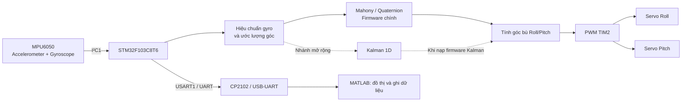

# Bệ cân bằng tự động 2 trục (Gimbal) dùng MPU6050

> **Đề tài học phần:** Hệ thống nhúng  
> **Đơn vị:** Học viện Kỹ thuật Mật mã – Khoa Điện tử - Vi mạch  
> **Giảng viên hướng dẫn:** ThS. Nguyễn Thị Thanh Ngọc

## 1. Giới thiệu

Dự án xây dựng mô hình bệ cân bằng hai trục **Roll** và **Pitch**, sử dụng vi điều khiển **STM32F103C8T6**, cảm biến quán tính **MPU6050** và hai động cơ servo **MG90S**. MPU6050 đo gia tốc và vận tốc góc; firmware xử lý dữ liệu để ước lượng góc nghiêng, sau đó tạo lệnh PWM cho các servo nhằm bù lại chuyển động nghiêng của cơ cấu.

Dự án tập trung vào quá trình triển khai một hệ thống nhúng hoàn chỉnh: đọc cảm biến qua I²C, hiệu chuẩn con quay hồi chuyển, ước lượng tư thế, điều khiển PWM, truyền dữ liệu UART và đánh giá tín hiệu bằng MATLAB. Thuật toán **Mahony/quaternion** là phương pháp chính của firmware; **Kalman 1D** được triển khai như một nhánh mở rộng để khảo sát và so sánh.

## 2. Mục tiêu

- Thu thập dữ liệu gia tốc và vận tốc góc từ MPU6050 qua giao tiếp I²C.
- Hiệu chuẩn độ lệch ban đầu (bias) của gyroscope để giảm sai số khi ước lượng góc.
- Ước lượng góc Roll/Pitch bằng cách kết hợp thông tin cảm biến; triển khai Mahony/quaternion và khảo sát thêm Kalman 1D.
- Phát lệnh PWM điều khiển hai servo theo góc bù, có giới hạn lệnh để tránh đi quá phạm vi cơ cấu.
- Truyền dữ liệu đo và góc ước lượng qua UART để theo dõi, ghi dữ liệu và đánh giá bằng MATLAB.
- Kiểm thử từng khối và toàn hệ thống, ghi nhận cả kết quả đạt được lẫn giới hạn của mô hình.

## 3. Phạm vi và giới hạn

### Trong phạm vi

- Hai trục chuyển động: **Roll** và **Pitch**.
- Vi điều khiển STM32F103C8T6, cảm biến MPU6050 và hai servo MG90S.
- Đọc cảm biến qua I²C, xử lý dữ liệu trong firmware HAL, điều khiển servo bằng PWM.
- Firmware chính dùng Mahony/quaternion; phiên bản Kalman 1D là nhánh mở rộng/thử nghiệm.
- Giám sát các kênh góc bằng UART và MATLAB.

### Giới hạn cần lưu ý

- **Không xử lý Yaw** trong chức năng cân bằng hai trục của dự án.
- Cảm biến được đặt trên phần đế. Cấu hình hiện tại dùng góc ước lượng để tính lệnh bù trực tiếp, **chưa đo độc lập góc của mặt bệ phía trên để tạo vòng phản hồi ngoài**. Vì vậy, không nên mô tả hệ thống như một bộ điều khiển khép kín đã đo trực tiếp góc mặt bệ.
- Kalman 1D được khảo sát ở phiên bản firmware thay thế Mahony; nếu hai bộ lọc chưa được chạy song song trên cùng dữ liệu, kết quả của chúng cần được thu ở các lần chạy riêng và ghi rõ cấu hình firmware.
- Dải xung PWM phần mềm không đồng nghĩa với toàn bộ hành trình cơ khí của servo. Với các servo đã thử nghiệm, hành trình hữu dụng trong khoảng xung 1000–2000 µs vào khoảng 90° tổng; cần kiểm tra từng servo và cơ cấu trước khi gắn tải.
- Các tiêu chí như giữ mặt bệ trong ±3° hoặc nghiêng đế ±30° là **mục tiêu kiểm thử**, không tự động đồng nghĩa với kết quả đã đạt. Muốn kết luận cần có phép đo thực tế và góc tham chiếu phù hợp.

### Ghi chú về phạm vi phát triển

Bảng phân công ban đầu đề cập bộ lọc bù (complementary filter) và OLED. Báo cáo hiện tại mô tả firmware chính dùng Mahony/quaternion, nhánh mở rộng Kalman 1D và kênh giám sát UART/MATLAB. Vì vậy, README ưu tiên mô tả phần hiện thực được trình bày trong báo cáo; chỉ ghi nhận complementary filter hoặc OLED là tính năng đã hoàn thành khi mã nguồn và mô hình thực tế có triển khai tương ứng.

## 4. Kiến trúc hệ thống

Luồng xử lý cơ bản:

**MPU6050 → I²C → hiệu chuẩn và xử lý dữ liệu → ước lượng Roll/Pitch → tính góc bù → PWM servo**. UART được sử dụng cho mục đích giám sát và đánh giá, không phải đường điều khiển từ máy tính trong cấu hình hiện tại.

## 5. Phần cứng và kết nối chính

| Thành phần | Kết nối/chức năng |
|---|---|
| STM32F103C8T6 | Vi điều khiển trung tâm, chạy firmware HAL |
| MPU6050 | Đo gia tốc và vận tốc góc; giao tiếp I²C1 |
| I²C1 SCL / SDA | PB6 / PB7 trên STM32F103C8T6 |
| MPU6050 INT | PB12, dùng báo dữ liệu sẵn sàng theo cấu hình firmware |
| Servo Roll | TIM2_CH1 / PA0 |
| Servo Pitch | TIM2_CH2 / PA1 |
| USART1 TX / RX | PA9 / PA10; kết nối bộ chuyển USB–UART theo kiểu TX/RX chéo |
| CP2102 hoặc bộ USB–UART tương thích | Kết nối UART với máy tính để nhận dữ liệu |
| OLED (nếu được lắp trên phiên bản phần cứng) | Hiển thị cục bộ; không thay thế đường giám sát UART/MATLAB được mô tả trong báo cáo |
| Nguồn servo | Nguồn khoảng 5 V riêng; nối chung GND với STM32 |

**Lưu ý nguồn:** Không cấp dòng tải của servo trực tiếp từ chân 3,3 V của vi điều khiển. Dùng nguồn servo riêng phù hợp, nối chung mass tín hiệu và kiểm tra cực tính trước khi cấp nguồn.

## 6. Cấu hình và phương pháp xử lý

Các thông số dưới đây phản ánh cấu hình được mô tả trong báo cáo; cần đối chiếu lại với mã nguồn được commit nếu cấu hình firmware thay đổi.

| Hạng mục | Cấu hình được mô tả |
|---|---|
| Cảm biến | MPU6050, dải gia tốc ±2 g, dải gyroscope ±250°/s |
| Lấy mẫu | Tần số danh định 200 Hz, chu kỳ khoảng 5 ms; DLPF = 3, SMPLRT_DIV = 4 |
| Hiệu chuẩn gyro | Giữ cảm biến đứng yên và lấy trung bình 1000 mẫu để tính bias |
| Định thời | Dùng bộ đếm chu kỳ DWT để đo `dt`; dùng 5 ms dự phòng nếu `dt` nằm ngoài khoảng 1–50 ms |
| Ước lượng chính | Mahony/quaternion, có chuẩn hóa quaternion sau bước tích phân |
| Nhánh mở rộng | Kalman 1D cho hai trục Roll/Pitch; có điều kiện kiểm tra độ lớn vector gia tốc trước khi hiệu chỉnh bằng phép đo |
| PWM servo | TIM2_CH1/PA0 và TIM2_CH2/PA1; chu kỳ servo khoảng 20 ms; xung trong khoảng 1000–2000 µs |
| Góc tâm trong cấu hình báo cáo | Roll: 100°; Pitch: 90° |
| Giám sát UART | 115200 baud; bốn kênh `float32`: Roll Raw, Pitch Raw và Roll/Pitch sau bộ lọc tương ứng với firmware đang chạy; tốc độ truyền mục tiêu khoảng 50 Hz |

### Các mô-đun firmware chính

- `main.c`: khởi tạo ngoại vi và điều phối vòng lặp chính.
- `mpu6050.c` / `mpu6050.h`: khởi tạo cảm biến, đọc dữ liệu, hiệu chuẩn gyro, đo `dt` và thực hiện thuật toán ước lượng theo phiên bản firmware.
- `gimbal.c` / `gimbal.h`: căn chỉnh tư thế ban đầu, lấy Roll/Pitch và tính lệnh bù cho hai trục.
- `servo.c` / `servo.h`: khởi động PWM, đặt góc tâm và chuyển góc lệnh thành độ rộng xung.
- Script MATLAB: nhận frame UART, hiển thị các kênh góc, ghi dữ liệu và tính các chỉ tiêu phân tích khi có đủ dữ liệu thử nghiệm.

Tên và vị trí thực tế của các tệp có thể thay đổi theo cấu trúc repository; bảng trên mô tả vai trò chức năng của các mô-đun.

## 7. Phân công công việc theo thành viên

Phân công dưới đây được tổng hợp từ bảng phân công đề tài và cách tổ chức nội dung báo cáo. Các phần giao nhau cần được phối hợp khi tích hợp hệ thống.

### Nguyễn Quang Huân — DT070220

**Phụ trách: Đọc cảm biến và hiệu chuẩn gyroscope**

- Cấu hình và đọc MPU6050 qua I²C, hướng tới chu kỳ lấy mẫu 200 Hz.
- Xử lý tín hiệu báo dữ liệu sẵn sàng từ chân INT hoặc cơ chế định thời phù hợp.
- Hiệu chuẩn bias gyroscope khi cảm biến đứng yên; cung cấp dữ liệu đã hiệu chuẩn cho khối ước lượng.
- Kiểm tra giao tiếp cảm biến, đơn vị chuyển đổi dữ liệu và độ ổn định khi đứng yên.
- Phối hợp tích hợp và cung cấp số liệu kiểm thử cho báo cáo.

### Nguyễn Ngọc Phú — DT070235

**Phụ trách: Ước lượng góc và phân tích thuật toán lọc**

- Theo phân công ban đầu, khảo sát góc từ accelerometer, tích phân gyroscope và complementary filter để đối chiếu các cách ước lượng.
- Trong phiên bản được mô tả ở báo cáo, phụ trách phân tích Mahony/quaternion trong firmware chính và ghi rõ sự khác biệt so với phương án ban đầu.
- Triển khai/khảo sát nhánh Kalman 1D để so sánh với tín hiệu Raw và Mahony trong các điều kiện thử nghiệm phù hợp.
- Xây dựng kịch bản đo, xử lý dữ liệu MATLAB và tổng hợp các chỉ tiêu như độ lệch chuẩn, biên độ đỉnh–đỉnh; chỉ đánh giá sai số tuyệt đối khi có góc tham chiếu đáng tin cậy.
- Viết và rà soát nội dung báo cáo liên quan đến thuật toán, phương pháp đo và kết quả lọc.

### Phạm Quang Khải — DT070223

**Phụ trách: Điều khiển servo và tính toán góc bù**

- Cấu hình PWM cho hai servo bằng TIM2 và ánh xạ lệnh góc sang độ rộng xung theo micro giây.
- Xác định góc tâm, chiều quay, hệ số bù và giới hạn lệnh cho hai trục Roll/Pitch.
- Kiểm tra riêng từng servo trước khi tích hợp cơ cấu; xác nhận chiều bù đúng khi đế nghiêng.
- Kiểm soát hành trình lệnh để giảm nguy cơ servo va vào giới hạn cơ khí.
- Phối hợp đánh giá đáp ứng của cơ cấu và ghi nhận các giới hạn điều khiển.

### Bùi Trung Kiên — DT070228

**Phụ trách: Cơ khí, nguồn, giám sát và tích hợp hệ thống**

- Lắp ráp cơ cấu gimbal, bố trí cảm biến/servo và kiểm tra độ chắc chắn của hệ thống.
- Thiết kế và kiểm tra phương án cấp nguồn riêng cho servo, bảo đảm GND chung với mạch điều khiển.
- Tích hợp các mô-đun cảm biến, thuật toán và servo; xử lý lỗi phát sinh giữa các khối.
- Phối hợp xây dựng kênh giám sát UART/MATLAB và phần hiển thị phụ trợ nếu được triển khai trên phần cứng thực tế.
- Tổ chức demo, đánh giá phản ứng khi nghiêng đế, tổng hợp hình ảnh/kết quả và hoàn thiện báo cáo chung.

> **Lưu ý tên thành viên:** Bảng Excel phân công ghi “Nguyễn Trung Kiên” ở tiêu đề cột, trong khi danh sách thành viên và báo cáo ghi “Bùi Trung Kiên” với cùng mã DT070228. README này dùng tên trong danh sách thành viên của báo cáo; nhóm nên xác nhận lại trước khi công bố chính thức.

## 8. Kịch bản kiểm thử và tiêu chí đánh giá

Nên kiểm thử lần lượt từng khối trước khi đánh giá toàn hệ thống:

1. **Kiểm tra cảm biến:** khởi tạo MPU6050, xác nhận giao tiếp I²C và dữ liệu đọc hợp lệ.
2. **Kiểm tra hiệu chuẩn:** giữ cảm biến bất động trong giai đoạn hiệu chuẩn; kiểm tra vận tốc góc sau bù bias.
3. **Kiểm tra tín hiệu góc:** đặt cảm biến đứng yên rồi nghiêng lần lượt theo Roll và Pitch; so sánh Raw với tín hiệu sau lọc.
4. **Kiểm tra servo riêng lẻ:** xác nhận đúng kênh, chiều quay, góc tâm và hành trình an toàn.
5. **Kiểm tra tích hợp:** nghiêng đế theo từng trục, sau đó thử hai trục; quan sát chiều và mức bù của bệ.
6. **Kiểm tra UART/MATLAB:** xác nhận đúng cổng COM, baud rate, thứ tự kênh và việc ghi dữ liệu không làm sai lệch quá trình đo.
7. **Thử nghiệm định lượng:** ghi rõ góc đặt, thời gian thu, vị trí lắp cảm biến, phiên bản firmware và điều kiện cơ khí của từng lần đo.

Các kịch bản nghiêng đế đến ±30° và mục tiêu giữ mặt bệ trong ±3° có thể dùng làm **mốc đánh giá theo yêu cầu ban đầu**. Chỉ báo cáo là đạt khi có phép đo xác nhận. Kết quả giảm độ dao động trong thử nghiệm tĩnh không tự nó chứng minh độ chính xác tuyệt đối hoặc độ trễ khi chuyển động.

## 9. Cách chạy và sử dụng

Do thao tác build/nạp phụ thuộc cấu trúc project được đưa lên repository, hãy sử dụng tệp project và cấu hình build thực tế có trong repo. Quy trình kiểm tra tổng quát:

1. Kiểm tra dây nguồn, GND chung, dây I²C, chân INT và hai đường PWM trước khi cấp điện.
2. Nạp đúng phiên bản firmware: **Mahony/quaternion** cho cấu hình chính hoặc **Kalman 1D** cho phép thử mở rộng.
3. Giữ cảm biến đứng yên trong thời gian khởi động và hiệu chuẩn theo firmware.
4. Kết nối UART qua CP2102/USB–UART, chọn cổng COM đúng và baud rate 115200.
5. Mở script MATLAB tương ứng với phiên bản firmware; kiểm tra nhãn kênh trước khi ghi dữ liệu.
6. Thực hiện từng kịch bản thử nghiệm và lưu dữ liệu thô cùng thông tin điều kiện đo để có thể đối chiếu lại.

**An toàn khi thử nghiệm:** lần đầu nên tháo tải nặng, đặt servo gần góc tâm, kiểm tra giới hạn cơ khí và cấp nguồn servo riêng. Không ép trục servo vượt hành trình và ngắt nguồn khi dây nóng bất thường, servo kẹt hoặc vi điều khiển liên tục reset.

## 10. Cấu trúc nội dung báo cáo

- **Chương 1 – Cơ sở lý thuyết:** các thiết bị chính và nền tảng liên quan.
- **Chương 2 – Giải pháp thiết kế:** sơ đồ khối, yêu cầu, luồng xử lý và lựa chọn thuật toán.
- **Chương 3 – Hiện thực và tích hợp hệ thống:** cấu trúc firmware, cảm biến, quaternion, servo và giám sát MATLAB.
- **Chương 4 – Mở rộng với Kalman 1D:** mô hình, hiện thực, tham số và phương pháp so sánh.
- **Chương 5 – Kết quả và đánh giá:** sản phẩm thực tế, dữ liệu đo, nhận xét và giới hạn.

## 11. Hướng phát triển

- Bổ sung cảm biến hoặc phương pháp đo độc lập góc của mặt bệ để đánh giá trực tiếp chất lượng cân bằng và tiến tới vòng điều khiển ngoài khép kín.
- Chuẩn hóa quy trình so sánh Mahony và Kalman 1D trên cùng dữ liệu, cùng điều kiện thử nghiệm; cân nhắc chạy song song hai bộ lọc để so sánh trực tiếp.
- Đánh giá thêm đáp ứng động, độ trễ, sai số so với góc tham chiếu và ảnh hưởng của rung động cơ học.
- Hoàn thiện hiển thị OLED nếu đây là yêu cầu cần có trong phiên bản phần cứng bàn giao.

## 12. Đóng góp và phối hợp

Các thành viên cần ghi nhận rõ phần việc của mình trong commit hoặc tài liệu làm việc, nêu được thay đổi kỹ thuật và cách kiểm tra. Khi thay đổi cấu hình chân, tốc độ lấy mẫu, thứ tự kênh UART, tham số lọc hoặc chiều servo, cần cập nhật tài liệu và thông báo cho thành viên phụ trách tích hợp để tránh sử dụng nhầm cấu hình.

Mọi số liệu trong README/báo cáo cần xuất phát từ lần đo thực tế có thể đối chiếu; không tự điền kết quả mong muốn vào bảng kết quả khi chưa thử nghiệm.

## 13. Tài liệu tham khảo chính

1. InvenSense, *MPU-6000 and MPU-6050 Product Specification*.
2. InvenSense, *MPU-6000 and MPU-6050 Register Map and Descriptions*.
3. STMicroelectronics, *STM32F103x8, STM32F103xB Datasheet*.
4. STMicroelectronics, *RM0008: Reference Manual – STM32F101xx/102xx/103xx/105xx/107xx*.
5. R. Mahony, T. Hamel, and J.-M. Pflimlin, “Nonlinear Complementary Filters on the Special Orthogonal Group,” *IEEE Transactions on Automatic Control*, vol. 53, no. 5, pp. 1203–1218, 2008, doi: [10.1109/TAC.2008.923738](https://doi.org/10.1109/TAC.2008.923738).
6. G. Welch and G. Bishop, *An Introduction to the Kalman Filter*, Technical Report TR 95-041, University of North Carolina at Chapel Hill, 1995.
7. NXP Semiconductors, *UM10204: I²C-bus Specification and User Manual*.

Chỉ giữ lại trong danh mục cuối những tài liệu nhóm thực sự đã tham khảo và sử dụng trong quá trình thực hiện.

---

**Từ khóa:** STM32F103C8T6 · MPU6050 · Gimbal 2 trục · Mahony Filter · Quaternion · Kalman 1D · Servo PWM · I²C · UART · MATLAB
